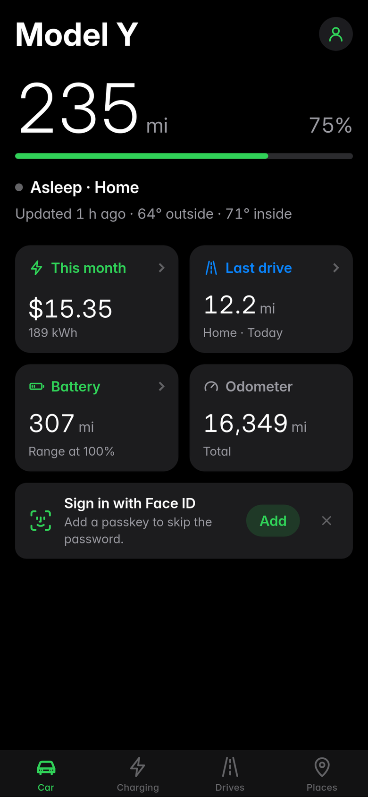
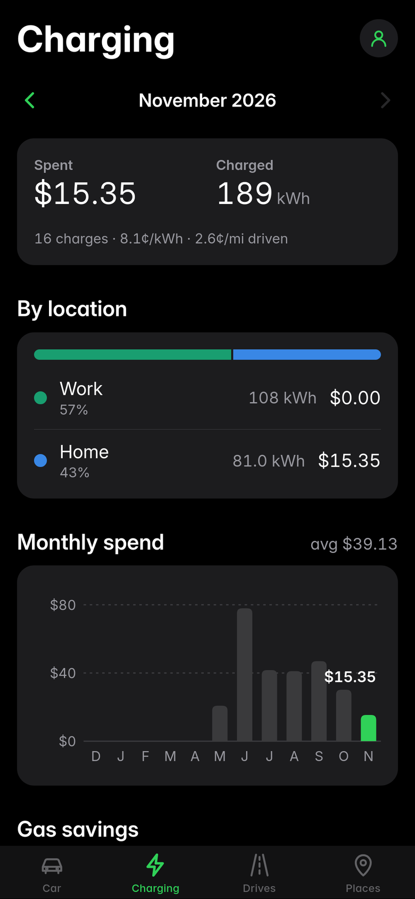
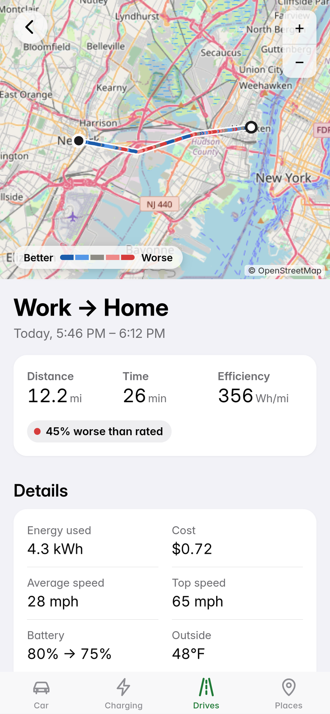
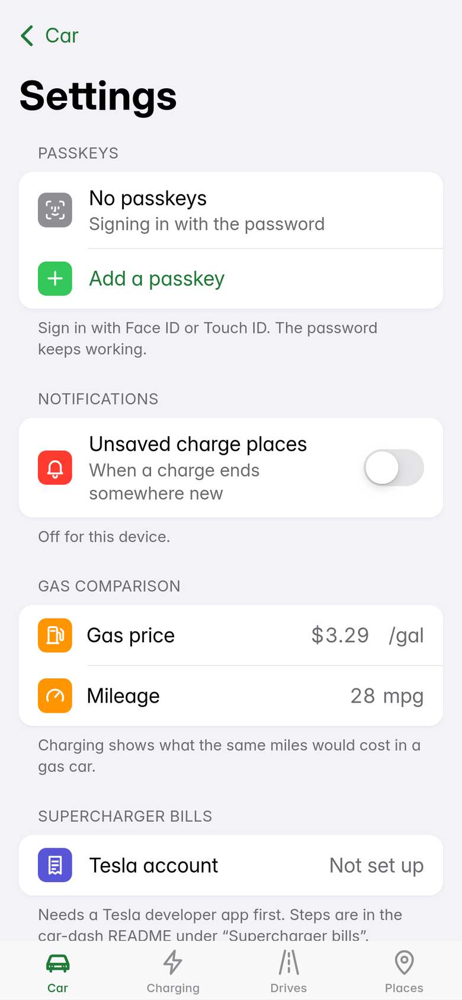

# Car

A phone app for your Tesla's [TeslaMate](https://github.com/teslamate-org/teslamate) data:
what charging really costs by place, drives colored by efficiency, battery health, and a
quick look at the car. Install it to your iPhone or Android home screen (it's a PWA), sign
in with Face ID, and it feels like a native app.

<p>
  
  
  
  
</p>

<sub>Screenshots use made-up demo data.</sub>

- **Charging:** monthly spend and kWh, split by place (Home, Work, Supercharger, …), a
  12-month spend chart, savings versus a gas car, and every charge with its power curve.
  Type in what you paid, or let a place's price (per kWh or per minute, plus session fee)
  work it out, including for charges from before you set the price.
- **Drives:** 30-day efficiency against the car's rated figure, a map of your routes
  colored from better to worse than rated, weekly efficiency, efficiency by outside
  temperature, and per-drive speed, power and elevation.
- **Places:** create and edit TeslaMate geofences on a map, with suggestions for spots
  you've charged at but not saved.
- **Battery health:** estimated range at 100% over time.
- **Notifications** when a charge ends somewhere you haven't saved (Web Push, no outside service).
- **Supercharger bills** pulled from your Tesla account (optional, Tesla Fleet API).
- Passkeys (Face ID / Touch ID), works offline from the last data it saw, light and dark mode.

No build step and no front-end dependencies: FastAPI + Postgres on the server, vanilla JS,
hand-built SVG charts and OpenStreetMap tiles on the phone. TeslaMate itself is not modified.

## Requirements

- A running TeslaMate with its Postgres database (Docker Compose setup).
- An HTTPS hostname for the app behind a reverse proxy (Caddy, Traefik, nginx, …). Passkeys,
  service workers and push notifications all need HTTPS.

## Install

1. **Database role.** Edit the password in [`setup.sql`](setup.sql), then run it as
   TeslaMate's database superuser:
   ```bash
   docker compose exec -T database psql -U teslamate -d teslamate < car-dash/setup.sql
   ```
2. **Secrets.** Copy [`.env.example`](.env.example) into the `.env` next to your
   `docker-compose.yml` and fill it in (`openssl rand -base64 48` makes a good secret).
3. **Service.** Put this folder next to your `docker-compose.yml` as `car-dash/` and add the
   service from [`docker-compose.example.yml`](docker-compose.example.yml). Set `RP_ID` to the
   app's hostname.
4. **Proxy.** Point your HTTPS hostname at port 8000 and make sure the proxy sets `X-Real-IP`
   (used to rate-limit wrong passwords per client).
5. `docker compose up -d --build car-dash`, open the site, sign in with the password, and
   add a passkey on the Settings screen. On iPhone: Share › Add to Home Screen.

### Settings

| Variable | |
|---|---|
| `RP_ID` | **Required.** Hostname the app is served on, e.g. `car.example.com`. Passkeys are bound to it. |
| `ORIGIN` | Full origin, default `https://$RP_ID`. |
| `CAR_DASH_PASSWORD` | **Required.** Sign-in password. |
| `CAR_DASH_SECRET` | **Required.** Signs session cookies and encrypts tokens/keys the app stores. Changing it signs everyone out. |
| `CAR_DASH_DB_PASSWORD` | **Required.** Password of the `car_dash` database role. |
| `DB_HOST`, `DB_NAME` | TeslaMate's Postgres, default `teslamate-db` / `teslamate`. |
| `TZ` | Time zone for times and month boundaries, default `UTC`. |
| `TESLAMATE_URL` | Optional link to TeslaMate's web UI (shown when the car goes quiet). |
| `MAP_TILES`, `MAP_CREDIT` | Tile URL template (`{z}/{x}/{y}`) and credit. Default: OpenStreetMap, fine for one person's light use ([tile policy](https://operations.osmfoundation.org/policies/tiles/)); use another provider or your own tile server otherwise. |
| `TESLA_CLIENT_ID`, `TESLA_CLIENT_SECRET` | Optional, for Supercharger bills. |

## How it works

- **Database access:** role `car_dash` (see `setup.sql`).
  - `SELECT` on `public`; nothing on the `private` schema (Tesla tokens).
  - Writes to TeslaMate tables only from actions you take in the app:
    `UPDATE (cost, geofence_id)` on `charging_processes`,
    `UPDATE (start_geofence_id, end_geofence_id)` on `drives`, and
    `INSERT/UPDATE/DELETE` on `geofences` (Places screen).
  - Owns schema `car_dash`; the app creates its tables there at startup (`SCHEMA` in
    `app/main.py`): `manual_costs`, `passkeys`, `drive_energy`, `app_state`,
    `push_subscriptions`, `tesla_bills`.
- **Places:** a charge's place is its TeslaMate geofence, matched by location when TeslaMate
  didn't link one (so a place tagged later prices old charges too); else "Supercharger" (Tesla
  DC charger) or "Untagged".
- **Cost**, first that applies: a cost typed into the app → Tesla's bill for that Supercharger
  session → `charging_processes.cost` stored by TeslaMate → free Supercharging → the place's
  rate × energy drawn from the charger (`charge_energy_used`, falling back to `added`) + session fee.
- **Sign-in:** one password → signed HttpOnly cookie valid 400 days, plus passkeys (WebAuthn).
  - Wrong passwords: 5 per client IP (from the proxy's `X-Real-IP`) per 10 minutes, **and** 20
    from everyone together per 10 minutes, which holds even if that header were forged. Passkey
    sign-in isn't subject to the shared cap, so the owner can't be locked out.
  - Settings › **Sign out all other devices** invalidates every older cookie.
  - Changes are accepted only from the app's own pages (`Sec-Fetch-Site`), on top of
    `SameSite` cookies, so other sites on the same domain can't act for you.
- **Stored secrets** (Tesla tokens, push and Tesla key pairs) are encrypted with a key derived
  from `CAR_DASH_SECRET`.
- **Stale data:** if TeslaMate hasn't recorded anything for 36 h and the car isn't driving or
  charging, the Car screen says so. Usually the car is just asleep; if it has been driven,
  Tesla has probably signed TeslaMate out.
- **Health:** `GET /healthz` (no sign-in) checks the database; the image's `HEALTHCHECK` uses it.
- **Place colors** are a validated categorical set (checked for color-blind separation and
  contrast in both modes): geofences take slots 1–5 in id order, Supercharger is orange,
  Untagged is gray.

### Drives and efficiency

- **Energy per drive** is integrated from `positions.power` (TeslaMate logs ~4 Hz while
  driving; gaps capped at 30 s) and cached per finished drive. Drives without power data fall
  back to rated-range drop × `cars.efficiency`. Per-mile figures are hidden for drives under
  0.5 mi, and runs of tiny moves (parking lots) fold into one row in the list.
- **Rated** = `cars.efficiency` (TeslaMate learns it from charges). Until then a typical figure
  per model is used (`TYPICAL_EFFICIENCY` in `main.py`) and the app says so.
- **Route colors:** 5-step diverging scale against rated (blue better, gray about rated, red
  worse; regen counts as better), smoothed over ±30 s so stop-and-go doesn't stripe.
- Drive cost = energy × the average $/kWh you actually paid over the last 90 days.

### Battery health and gas comparison

- Range at 100% comes from the end of each charge that finished at ≥50% (rated range ÷
  usable % × 100); capacity = that × `cars.efficiency`. A trend appears after ten charges.
- Gas comparison: enter a gas price and mileage in Settings (mpg and $/gal, or L/100 km and
  price per litre if TeslaMate uses km). Nothing is assumed until you do.

### Notifications

Settings › Notifications. On iPhone the app must be on the Home Screen first (iOS 16.4+).
Every minute the server looks for charges that ended in the last 6 hours at an unsaved place
and notifies each subscribed device; the text names no address. The VAPID key pair is made on
first use and stored encrypted.

### Supercharger bills (Tesla Fleet API, optional)

Once connected, the app reads `GET /api/1/dx/charging/history` every 6 hours, stores each
session's bill and matches it to the TeslaMate charge that started within 20 minutes. It
never writes TeslaMate's tables and never sends commands. Tesla's only scope for charging
history is `vehicle_charging_cmds`, which also allows starting/stopping charging; the app
requests it but only reads.

1. At [developer.tesla.com](https://developer.tesla.com), create an application: allowed origin
   `https://car.example.com`, redirect URI `https://car.example.com/api/tesla/callback`, scope
   "Vehicle Charging Management". Fleet API usage is billed per request (with a monthly credit);
   this app makes a handful of requests a day.
2. Set `TESLA_CLIENT_ID` and `TESLA_CLIENT_SECRET` (`TESLA_API` defaults to the North America
   Fleet API) and rebuild.
3. Check that `https://car.example.com/.well-known/appspecific/com.tesla.3p.public-key.pem`
   loads through your proxy (the app generates and serves it; Tesla requires it).
4. Settings › Supercharger bills › **Register this site with Tesla**, then **Connect Tesla account**.

## Development

Edit `app/` or `static/` and rebuild. After changing CSS/JS, bump `?v=` in
`static/index.html` **and** `VERSION` + `SHELL` in `static/sw.js`, or installed phones keep
the old files (the page itself is always revalidated, so a bump reaches them on next open).

**Demo with fake data:** `dev/demo-db.sh` copies your TeslaMate *schema* (no data) into a
throwaway `teslamate_demo` database, fills it with ~6 months of made-up data
(`dev/demo-seed.py`) and runs a `car-dash-demo` container on http://localhost:18000 that
mounts `static/` and `app/`, so edits show on reload. Your real database is untouched.

```bash
docker build -t car-dash:next .
IMAGE=car-dash:next ENV_FILE=../.env dev/demo-db.sh   # create + seed + start
dev/demo-db.sh --down                                 # remove it
```

**Tests and screenshots** drive Firefox through geckodriver over plain WebDriver (no Selenium):

```bash
PW=<password> dev/ui-test.py                    # click-through: sign-in, passkeys, costs, places, settings
PW=<password> dev/screenshot.py shots 390 844 car='#/car' charging='#/charging' --dark
```

`dev/make-icons.py` regenerates the app icon (`static/icons/icon.svg` and the PNGs, needs Pillow).

## License

[MIT](LICENSE). Map data © OpenStreetMap contributors. Not affiliated with Tesla or TeslaMate.
